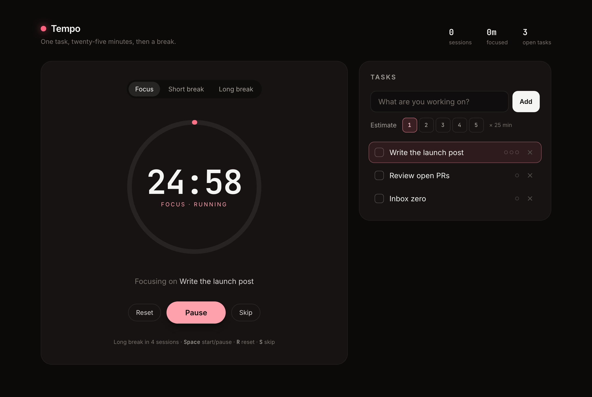

# Tempo

A focus timer with a task list, built on [Effect UI](https://github.com/Effect-TS/ui) (`@effect/ui` + `@effect/ui-kit`).



```sh
pnpm install
pnpm dev        # http://localhost:5173
pnpm test       # Story tests for every component
pnpm typecheck
pnpm build
```

Effect UI is in public preview and not on npm yet. Both packages are pinned to snapshot builds of commit `61b40b4` from pkg.pr.new.

## How it's put together

| File | Role |
| --- | --- |
| `src/domain/*` | Schemas and pure functions (phases, tasks, saved state). No framework imports. |
| `src/components/Timer.ts` | Phase, status and countdown in its own Model. A clock Subscription runs only while running; keyboard shortcuts via `HtmlSubscription.shortcuts`. Emits `Finished` to its parent and chimes through a `Command.Service`. |
| `src/components/NewTaskForm.ts` | Form validated with `Validation`, estimate picked with a kit `ToggleGroup`. Emits `Submitted`. |
| `src/App.ts` | Root. Owns tasks and totals, credits the active task when focus finishes, saves after each change with a `switch`-mode `SaveState` Command. |
| `src/services/*` | `TempoStore` (localStorage via `KeyValueStore`) and `Chime` (WebAudio). Provided as platform Layers in `main.ts`. |

The countdown measures wall-clock time between ticks rather than counting ticks, so a throttled background tab still finishes on time and paused time isn't counted.

Shortcuts: <kbd>Space</kbd> start/pause, <kbd>R</kbd> reset, <kbd>S</kbd> skip. They're ignored while typing in a field.
